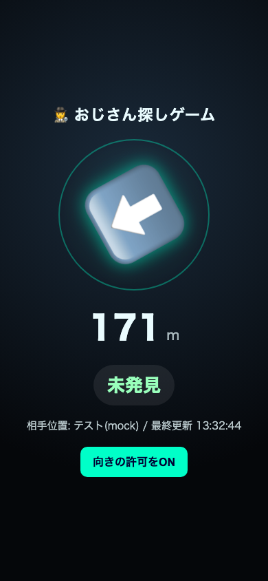

# おじさん探しゲーム (gmaps-share-finder)

[](https://github.com/Ryoseiimai/gmaps-share-finder/actions/workflows/ci.yml)
[](https://codespaces.new/Ryoseiimai/gmaps-share-finder)
[](LICENSE)

Googleマップの「現在地の共有」を使った、リアル鬼ごっこ／かくれんぼ用のちょっとした実験ツールです。
スマホの画面には**距離と方角の矢印だけ**が表示され、座標そのものはどこにも表示されません。

🎮 インストール不要でブラウザだけで触れるモック画面: **[Live Demo](https://ryoseiimai.github.io/gmaps-share-finder/)**（実際のWorker・アカウントには一切接続しません）


## 3分で動かす

Googleアカウントも Cloudflareアカウントも不要です。

```bash
git clone https://github.com/Ryoseiimai/gmaps-share-finder.git
cd gmaps-share-finder
npm run dev   # または: make dev
```

`wrangler dev` をローカルのみで起動し、ダミーの相手位置を自動で流し込み、ブラウザで画面を開きます。止めるときは `Ctrl+C`。



ローカルに何もインストールしたくない場合は、上の「Open in GitHub Codespaces」バッジからブラウザだけで同じ開発環境を起動できます。

本物のGoogleマップの位置共有につないで自分のCloudflareへ配備したい場合は、下の「セットアップ」を参照してください。

## これは何か

- Mac上の小さなポーラー（Python）が定期的に、Googleマップで現在地共有をしてくれている相手の位置を取得します。
- 座標はCloudflare Workers + KVに一時保存され、TTL（2時間）で自動的に消えます。
- スマホのブラウザ画面は、自分のGPSをWorkerに送り、Workerから「距離(m)」と「方角(度)」だけを受け取って矢印を回転させます。座標そのものはスマホ側にもレスポンスにも含まれません。
- 距離が一定以内に近づくと、「見つけた」かどうかの判定（オプション機能）を行い、画面に表示します。

## 仕組み（構成図）

```
[相手のスマホ]                     [自分(ハンター)のスマホ]
  Googleマップの位置共有               ブラウザでWorkerのURLを開く
       │ (相手が自分で共有した場合のみ)         │ GPS(Geolocation API)
       ▼                                  ▼
[Mac poller (Python, 60秒毎)] ----POST----> [Cloudflare Worker]
   locationsharinglibで取得                    │  座標をKVに保存(TTL 2h)
   相手が見つからなければMOCK座標を送る          │  /state は距離・方角・判定だけを返す
                                               ▼
                                        [Workers KV]
```

- `worker/` — Cloudflare Worker本体（Hono不使用、素のFetch API）。エンドポイントは `POST /hunter`, `POST /target`, `POST /judge`, `GET /state`, `GET /`（スマホ用HTML）。距離・方角の計算は `worker/src/geo.js` に分離してあり、`worker/test/` でユニットテストしています。
- `poller/` — Mac側で動かす常駐スクリプト。`run.sh` が `poll.py` を一定間隔で呼び続けます。
- `scripts/get_cookies.py` — （実データを使う場合のみ）コピーしたChromeプロファイルからGoogleのCookieを取り出すヘルパー。本物のChromeプロファイルは操作しません。
- `scripts/dev.sh` / `scripts/dev_mock_feed.py` — 「3分で動かす」用の開発モード一式（`npm run dev` / `make dev` から呼ばれます）。
- `docs/index.html` — ブラウザだけで動くモック画面（GitHub Pagesで公開、上記Live Demo）。実際のWorkerには接続しません。
- 「見つけた」判定は、距離が近づいたときに任意の判定ロジック（同梱の `poller/poll.py` はClaude Codeの `jev-judge` スキルを呼び出す実装例）で行います。このスキルが無くても、距離と方角の表示自体は動作します。

## セットアップ（本物のGoogleマップ位置共有につなぐ場合）

「3分で動かす」はダミー座標だけで動く開発モードです。実際にGoogleマップの位置共有につなぎ、自分のCloudflareアカウントへ配備する場合は以下の手順を行ってください。

1. `cd worker && wrangler kv namespace create OJISAN_KV` でKV名前空間を作成し、出力されたIDを `worker/wrangler.toml` の `id` に設定する。
2. `wrangler secret put SHARED_TOKEN` で共有トークン（自分で好きな文字列を決める）を設定する。
3. `wrangler deploy` でWorkerを配備する。
4. `cp config.example.json config.json` してから、`worker_url`・`shared_token`・`target_display_name_contains` などを自分の環境に合わせて書き換える。
5. `python3 -m venv .venv && ./.venv/bin/pip install locationsharinglib playwright`（実データを使わない場合は`locationsharinglib`は不要）。
6. （実データを使う場合のみ）`./.venv/bin/python3 scripts/get_cookies.py` でCookieを取得し `secret/cookies.txt` に保存する。
7. `bash poller/run.sh` でポーラーを起動する（止めるときは `bash poller/stop.sh`）。
8. スマホのブラウザで `https://<自分のWorkerのURL>/?token=<自分で決めた共有トークン>` を開く。

## 利用条件（必ず読んでください）

**このツールは、相手が自分の意思でGoogleマップの「現在地の共有」機能をONにし、あなたに共有している場合にのみ、実データで動作します。**
相手が共有していない場合は、実際の位置情報は一切取得できず、自動的にダミー座標（MOCK）で動作します。

SNSの投稿・タグ付け・写真のExif情報など、公開情報から他人の居場所を推測・特定する目的での利用は想定していません。そのような目的には使わないでください。本人の同意なしに位置情報を取得・追跡することは、利用しているサービスの規約やプライバシーに関する法令に違反する可能性があります。

## 貢献 (Contributing)

Issue・PR歓迎です。開発モードの起動方法やPRの出し方は [CONTRIBUTING.md](CONTRIBUTING.md) を、行動規範は [CODE_OF_CONDUCT.md](CODE_OF_CONDUCT.md) を、脆弱性報告と受け付けない変更は [SECURITY.md](SECURITY.md) を参照してください。AIコーディングエージェントを使う場合は [AGENTS.md](AGENTS.md) / [CLAUDE.md](CLAUDE.md) にも目を通してください。

小さな修正（誤字・翻訳・README改善など）は、Forkしなくても GitHub上のファイル右上の鉛筆アイコンから直接編集提案（PR）を送れます。

## ライセンス

MIT License（`LICENSE` ファイル参照）

---

# gmaps-share-finder (English)

A small experiment for real-life hide-and-seek that uses Google Maps' "Share your real-time location" feature.
The phone screen only ever shows **distance and a direction arrow** — raw coordinates are never displayed.

🎮 Want to poke at it with zero install? **[Live Demo](https://ryoseiimai.github.io/gmaps-share-finder/)** — a fully client-side mock, never connects to a real Worker or account.

## 3-minute quickstart

No Google account and no Cloudflare account required.

```bash
git clone https://github.com/Ryoseiimai/gmaps-share-finder.git
cd gmaps-share-finder
npm run dev   # or: make dev
```

This starts `wrangler dev` in local-only mode, feeds in a mock target position automatically, and opens the phone screen in your browser. Stop with `Ctrl+C`.


Prefer not to install anything locally? Use the "Open in GitHub Codespaces" badge above to get the same dev environment in your browser.

Want to connect it to a real Google Maps share and deploy it to your own Cloudflare account? See "Setup" below.

## What it is

- A small Python poller running on a Mac periodically checks whether the target has shared their real-time location with you via Google Maps.
- Coordinates are stored temporarily in Cloudflare Workers KV with a 2-hour TTL (auto-expire).
- The phone screen sends its own GPS to the Worker and receives back only "distance (m)" and "bearing (degrees)" to rotate an arrow. Raw coordinates are never included in any response sent to the phone.
- When the distance gets close enough, an optional "found" judgment step runs and is shown on screen.

## How it works

```
[Target's phone]                      [Hunter's phone (you)]
  Google Maps location sharing            Open the Worker URL in a browser
       │ (only if the target shared it)          │ GPS (Geolocation API)
       ▼                                         ▼
[Mac poller (Python, every 60s)] --POST--> [Cloudflare Worker]
   fetches via locationsharinglib               │ stores coords in KV (TTL 2h)
   falls back to MOCK coords if not found        │ /state returns distance/bearing/judgment only
                                                  ▼
                                           [Workers KV]
```

- `worker/` — the Cloudflare Worker (plain Fetch API, no framework). Endpoints: `POST /hunter`, `POST /target`, `POST /judge`, `GET /state`, `GET /` (phone HTML page). Distance/bearing math lives in `worker/src/geo.js`, unit-tested under `worker/test/`.
- `poller/` — the Mac-side daemon. `run.sh` calls `poll.py` on a fixed interval.
- `scripts/get_cookies.py` — (only needed for real data) extracts Google cookies from a **copied** Chrome profile. It never touches your real Chrome profile.
- `scripts/dev.sh` / `scripts/dev_mock_feed.py` — the "3-minute quickstart" dev mode (invoked by `npm run dev` / `make dev`).
- `docs/index.html` — the browser-only mock screen published via GitHub Pages (the Live Demo above). Never connects to a real Worker.
- The "found" judgment is a pluggable step; the bundled `poller/poll.py` calls a Claude Code skill (`jev-judge`) as an example. The distance/direction display works fine without it.

## Setup (connecting to a real Google Maps share)

The "3-minute quickstart" above is a dev mode that only ever uses dummy coordinates. To connect it to a real Google Maps location share and deploy it to your own Cloudflare account, follow these steps.

1. `cd worker && wrangler kv namespace create OJISAN_KV`, then put the resulting id into `worker/wrangler.toml`.
2. `wrangler secret put SHARED_TOKEN` to set your own shared secret token.
3. `wrangler deploy` to deploy the Worker.
4. `cp config.example.json config.json` and fill in `worker_url`, `shared_token`, `target_display_name_contains`, etc.
5. `python3 -m venv .venv && ./.venv/bin/pip install locationsharinglib playwright` (skip `locationsharinglib` if you only want MOCK mode).
6. (Real data only) run `./.venv/bin/python3 scripts/get_cookies.py` to save cookies to `secret/cookies.txt`.
7. `bash poller/run.sh` to start the poller (`bash poller/stop.sh` to stop).
8. Open `https://<your-worker-url>/?token=<your-shared-token>` on your phone.

## Terms of use (please read)

**This tool only works with real data if the other person has themselves turned on Google Maps' "Share your real-time location" and shared it with you.** If they haven't, no real location is ever obtained, and the app automatically falls back to dummy (MOCK) coordinates.

This project is not intended for inferring or identifying someone's whereabouts from public information such as social media posts, tags, or photo EXIF data. Don't use it for that. Obtaining or tracking someone's location without their consent may violate the terms of service of the platforms involved and/or applicable privacy laws.

## Contributing

Issues and PRs are welcome. See [CONTRIBUTING.md](CONTRIBUTING.md) for how to run dev mode and open a PR, [CODE_OF_CONDUCT.md](CODE_OF_CONDUCT.md) for community standards, and [SECURITY.md](SECURITY.md) for vulnerability reporting and changes we won't accept. Using an AI coding agent? Check [AGENTS.md](AGENTS.md) / [CLAUDE.md](CLAUDE.md) too.

For small fixes (typos, translations, README tweaks), you don't even need to fork — use the pencil ("Edit this file") icon on GitHub to propose a change directly.

## License

MIT License (see `LICENSE`)
